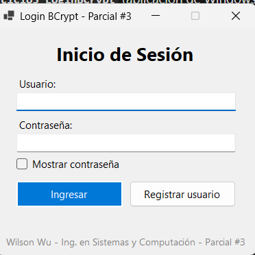
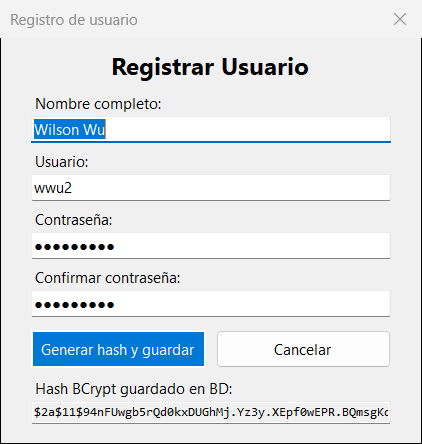
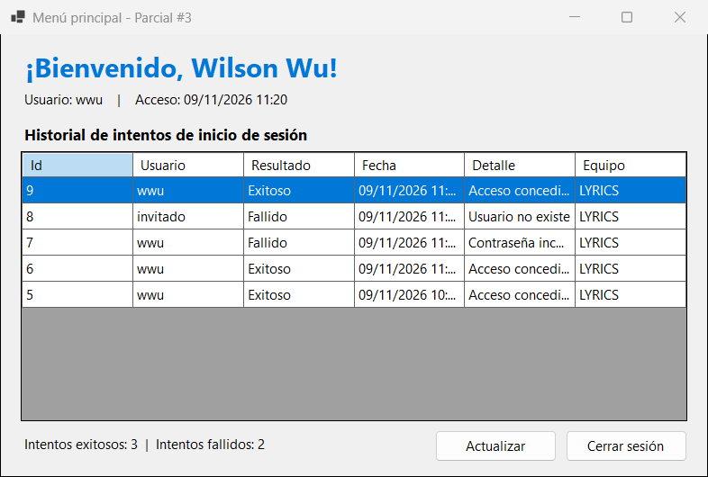

# Parcial # 3 (Práctico)

## 📅 Fecha: 09/11/2026

## 📋 Contenido del Repositorio

Solución de Visual Studio con los tres ejercicios prácticos del Parcial #3 de **Herramientas de la Programación Aplicada III (.NET)**:

1. **Ejercicio1_Figuras:** jerarquía de clases con la clase abstracta `Figura`, un arreglo `Figura[]` y un recorrido polimórfico.
2. **Ejercicio2_Json:** convierte un objeto a JSON con **Newtonsoft.Json**.
3. **Ejercicio3_LoginBCrypt:** login en Windows Forms que guarda las contraseñas como hash **BCrypt** en SQL Server y registra los intentos exitosos y fallidos.

## 🛠️ Tecnologías Utilizadas


- **Lenguaje / Framework:** C#, .NET 10, aplicaciones de consola y Windows Forms
- **Base de datos:** SQL Server Express 2025 con el conector Microsoft.Data.SqlClient
- **Paquetes NuGet:** Newtonsoft.Json y BCrypt.Net-Next
- **Herramientas:** Visual Studio 2026, Git y GitHub

## 🖥️ Capturas de Pantalla y Problemas

### Ejercicio 1: Figuras (Polimorfismo)

```plaintext
#  Clase        |       Área |  Perímetro
---------------------------------------------
1  Rectangulo   |      40,00 |      26,00
2  Cuadrado     |      36,00 |      24,00
3  Triangulo    |       6,00 |      12,00
4  Rectangulo   |      26,25 |      26,00
5  Cuadrado     |      10,24 |      12,80
6  Triangulo    |      21,22 |      21,00
---------------------------------------------
Área total de todas las figuras: 139,71
```

- **Clase abstracta (3 pts):** `Figura` funciona como molde obligatorio y no se puede instanciar.
- **Métodos abstractos desarrollados en las hijas (2 pts):** `Rectangulo`, `Cuadrado` y `Triangulo` implementan `CalcularArea()` y `CalcularPerimetro()` con `override`. El triángulo usa la fórmula de Herón y valida la desigualdad triangular.
- **Arreglo unidimensional de tipo padre (5 pts):** `Figura[] figuras` guarda objetos de las tres clases hijas.
- **Recorrido polimórfico (5 pts):** un bucle `for` trata cada objeto como `Figura` y en tiempo de ejecución se llama al método de la clase hija. El nombre de la clase se obtiene con `GetType().Name`.

### Ejercicio 2: JSON con Newtonsoft.Json

```plaintext
Hello, World!
{"Nombre":"Wilson Wu","Edad":21,"Carrera":"Ingenieria en Sistemas y Computacion"}
```

- **Paso 1 – Instalar:** `dotnet add package Newtonsoft.Json`
- **Paso 2 – Importar:** `using Newtonsoft.Json;`
- **Paso 3 – Crear el objeto:** un objeto anónimo con el nombre, la edad y la carrera.
- **Paso 4 – Convertir a JSON:** `JsonConvert.SerializeObject(persona)` y se muestra en consola.

### Ejercicio 3: Login con BCrypt

#### Inicio de sesión



#### Registro de usuario



#### Menú principal



- **Generar el hash (5 pts):** al registrar un usuario, `BCrypt.Net.BCrypt.HashPassword()` genera el hash con una sal aleatoria y factor de trabajo 11. En la tabla `Usuarios` solo se guarda el hash, nunca la contraseña.
- **Verificar la contraseña (5 pts):** al iniciar sesión se busca el hash del usuario y se compara con `BCrypt.Net.BCrypt.Verify()`.
- **Bitácora de intentos:** cada intento exitoso o fallido se guarda en `IntentosLogin` con el usuario, la fecha, el detalle (acceso concedido, contraseña incorrecta o usuario inexistente) y el equipo.
- **Nombre del usuario al entrar (5 pts):** si el acceso es correcto, `FrmPrincipal` muestra *"¡Bienvenido, {nombre}!"* junto con el historial y el resumen de intentos.
- **Consultas parametrizadas:** todas las consultas a SQL Server usan parámetros para evitar inyección SQL.

## 📁 Estructura de Carpetas o Directorios

```plaintext
Parcial-3/
├── BaseDatos/
│   ├── Parcial3_Login.sql        # Script que crea la BD, las tablas y el usuario inicial
│   └── Parcial3_Login.bak        # Copia de seguridad de la base de datos
├── docs/capturas/                # Imágenes de este README
├── Ejercicio1_Figuras/
│   ├── Figura.cs                 # Clase abstracta
│   ├── Rectangulo.cs             # Clases hijas
│   ├── Cuadrado.cs
│   ├── Triangulo.cs
│   └── Program.cs                # Arreglo Figura[] y recorrido polimórfico
├── Ejercicio2_Json/
│   └── Program.cs                # Serialización con Newtonsoft.Json
├── Ejercicio3_LoginBCrypt/
│   ├── Datos/
│   │   ├── Conexion.cs           # Cadena de conexión a SQL Server
│   │   └── UsuarioDAO.cs         # Registro, verificación BCrypt e intentos
│   ├── FrmLogin.cs               # Inicio de sesión
│   ├── FrmRegistro.cs            # Registro de usuarios (genera el hash)
│   └── FrmPrincipal.cs           # Bienvenida e historial de intentos
├── Parcial3.slnx                 # Solución de Visual Studio
└── README.md                     # Documentación del proyecto
```

## 🚀 Instrucciones de Ejecución / Uso

### Requisitos

- Visual Studio 2026 con el componente de desarrollo de escritorio .NET (.NET 10)
- SQL Server Express (instancia `.\SQLEXPRESS`)

### Pasos

1. Clona el repositorio y entra en la carpeta del proyecto:

   ```bash
   git clone https://github.com/Lyrics354/Parcial-3.git
   cd Parcial-3
   ```

2. Prepara la base de datos en SQL Server Management Studio, conectado a `.\SQLEXPRESS`. Puedes hacerlo de dos formas:
   1. Abrir y ejecutar `BaseDatos/Parcial3_Login.sql`.
   2. O restaurar el backup:

      ```sql
      RESTORE DATABASE Parcial3_Login FROM DISK = N'C:\ruta\Parcial3_Login.bak' WITH REPLACE;
      ```

3. Si tu instancia de SQL Server tiene otro nombre, cambia la cadena de conexión en `Ejercicio3_LoginBCrypt/Datos/Conexion.cs`.

4. Abre `Parcial3.slnx` en Visual Studio y restaura los paquetes NuGet.

5. Haz clic derecho sobre el ejercicio que quieras probar, elige **Establecer como proyecto de inicio** y pulsa `F5`.

6. En el login, entra con el usuario de prueba **`wwu`** y la contraseña **`Parcial3*`**, o crea uno nuevo con **Registrar usuario**.

7. Para ver los hash y los intentos guardados:

   ```sql
   USE Parcial3_Login;
   SELECT Id, NombreUsuario, NombreCompleto, PasswordHash FROM dbo.Usuarios;
   SELECT NombreUsuario, Exitoso, Fecha, Detalle FROM dbo.IntentosLogin ORDER BY Fecha DESC;
   ```

## 🧑‍🎓 Autor y Contexto

- **Nombre:** Wilson Wu (2-756-299)
- **Edad:** 21
- **Carrera:** Ingeniería en Sistemas y Computación
- **Institución:** Universidad Tecnológica de Panamá (UTP)
- **Grupo:** 1IL133
- **Instructora:** Ing. Irina Fong
- **Fecha de Realización:** 09/11/2026

## 📖 Referencias

- [Video de Apoyo](https://youtu.be/RtpLwEkYG-g?si=bhSXqrtAklyOt_NN)
- [BCrypt.Net-Next](https://github.com/BcryptNet/bcrypt.net)
- [Newtonsoft.Json](https://www.newtonsoft.com/json)
- [Documentación de Windows Forms](https://learn.microsoft.com/es-es/dotnet/desktop/winforms/)
- [Documentación de Microsoft.Data.SqlClient](https://learn.microsoft.com/es-es/sql/connect/ado-net/microsoft-ado-net-sql-server)
